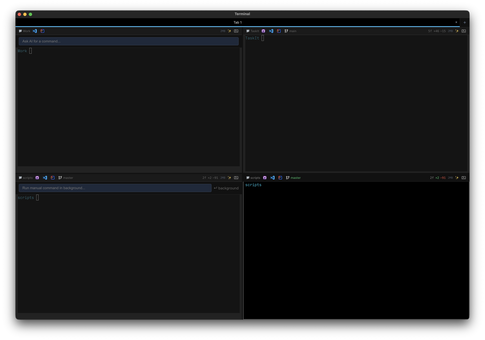

# PlumTerm



A modern, tabbed terminal application built with Qt 6 and Rust.

## Features
- **Tabbed Interface:** Multiple terminal sessions in one window.
- **Split Panes:** Vertical and horizontal splits with persistent resizing.
- **Renamable Tabs:** Double-click any tab to give it a custom name.
- **Global Hotkey:** Toggle app visibility from anywhere (default: `Cmd+Shift+T`).
- **Rerun Shortcut:** Quickly rerun the last command with `Cmd+R` (customizable).
- **macOS Optimized:** `Cmd+Q` quits the app, `Cmd+W` closes the window. Closing the last window also quits the app.
- **Git Integration:** Status bar shows current branch, dirty files, and PR info.
- **Change Count:** See the number of changed files at a glance directly in the status bar.
- **Open in GitHub Desktop:** Launch the current repo in GitHub Desktop with one click.
- **Open in IntelliJ:** Open the current project directly in IntelliJ IDEA from the terminal.
- **Open in Finder:** Reveal the current working directory in Finder instantly.
- **AI Commands:** Run AI-powered commands from within the terminal to assist with your workflow.
- **Background Commands:** Run long-running commands in the background and get notified when they finish.

## Installation

### Debian / Ubuntu

Download the latest `.deb` from the [Releases](https://github.com/pluminate/plumterm/releases) page and install it:

```bash
sudo apt install ./plumterm_*.deb
```

Otherwise, install from source:

### macOS

```bash
brew install qt cmake ninja
curl --proto '=https' --tlsv1.2 -sSf https://sh.rustup.rs | sh   # if you don't have Rust yet
./install-local.sh
```

This builds the app and installs `PlumTerm.app` into `/Applications`. To install somewhere else, pass the folder: `./install-local.sh ~/Applications`.

## Development

### Prerequisites
- Qt 6 (Widgets, Concurrent, Test, Svg)
- CMake and Ninja
- Rust (cargo)

### Build, test and run
```bash
cmake -S . -B build -G Ninja -DCMAKE_PREFIX_PATH=$(brew --prefix qt)
cmake --build build
ctest --test-dir build
./build/plumterm
```

See [ARCHITECTURE.md](ARCHITECTURE.md) for how the code is organised.

## License

PlumTerm is **source-available**, not open source.

- **Source code** (this repository): [PolyForm Strict License 1.0.0](LICENSE). You may read the code and use it for noncommercial purposes, but you may not modify it, redistribute it, or use it commercially.
- **Compiled app** (official releases): free to use under the [End-User Terms](EULA.md).

Copyright (c) 2024-2026 Pluminate. "PlumTerm" and "Pluminate" are names of the publisher; this license does not grant any right to use them.
